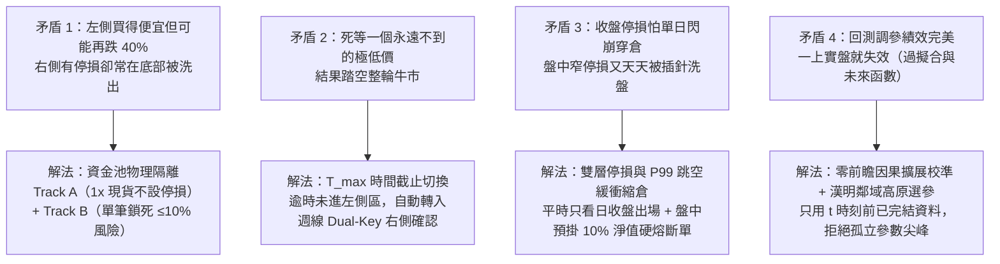

# 比特幣（BTC）雙軌多頭與防禦做空量化策略：完整規格書、設計哲學與人類改進指南

- **對應專案程式碼**：
  - 資料抓取與因果水位線驗證：[`scripts/btc_bottom/fetch_snapshots.py`](file:///home/antigravity/bitcoin-analyzer/scripts/btc_bottom/fetch_snapshots.py)
  - 零前瞻技術指標與結構算法：[`scripts/btc_bottom/indicators.py`](file:///home/antigravity/bitcoin-analyzer/scripts/btc_bottom/indicators.py)
  - Track A 長線左側價值區與雙鑰匙：[`scripts/btc_bottom/track_a.py`](file:///home/antigravity/bitcoin-analyzer/scripts/btc_bottom/track_a.py)
  - Track B 日線右側波段與尾端風控：[`scripts/btc_bottom/track_b.py`](file:///home/antigravity/bitcoin-analyzer/scripts/btc_bottom/track_b.py)
  - 雙軌回測引擎與影子帳本：[`scripts/btc_bottom/backtest_engine.py`](file:///home/antigravity/bitcoin-analyzer/scripts/btc_bottom/backtest_engine.py)
  - 右側做空微結構與防過擬合研究：[`scripts/btc_bottom/short_research.py`](file:///home/antigravity/bitcoin-analyzer/scripts/btc_bottom/short_research.py)

---

## 0. 核心設計哲學：這套系統在解決什麼問題？

多數交易者在比特幣市場虧損，不是因為看不懂均線或型態，而是死於**四個結構性矛盾**。本系統的每一條數學公式，都是為了正面解決這四個問題而設計：

1. **為什麼要拆成 Track A 與 Track B 兩個獨立資金池？**
   - **左側抄底（Track A）**賺的是「全市場流動性崩潰時的超額折價」，代價是你買進後還可能承受 `-20% ~ -35%` 的帳面浮虧（MAE）。如果你設停損，一定會在最低點被洗出去；因此 Track A 的鐵律是**「只用 1x 現貨、每輪熊市只出手一次、不設價格停損」**。
   - **右側波段（Track B）**賺的是「趨勢確立後的動能延續」，核心是**「絕對不能大賠」**。每一筆交易進場前就用歷史第 99 百分位（P99）跳空跌幅壓縮倉位，把單筆最差虧損鎖死在帳戶淨值的 **`-10%` 以內**。
   - 把兩者混在同一個帳戶，人腦就會在「本來該停損的右側單」找藉口凹單成左側，或在「本來該長抱的左側單」因為恐慌而砍倉。**物理隔離資金與規則，是克服人性弱點的第一步。**

2. **為什麼所有門檻都不用固定常數，而要用「因果擴展校準（Expanding Calibration）」？**
   - 比特幣早年（2011、2014）熊市動輒跌 `-85% ~ -93%`，但隨著市值擴大與機構化，2022 年最大跌幅已收斂至 `-77.3%`。
   - 如果你在 2014 年偷看 2022 年的數據來定規則，就叫**前瞻偏誤（Lookahead Bias）**；如果死守 `-85%` 才買，未來可能永遠買不到。
   - 因此系統規定：在歷史上任何一天 $t$，只能讀取「在 $t$ 之前**已經創下歷史新高、正式宣告完結**的舊熊市週期」，動態算出當下合理的跌幅門檻與最長等待天數 $T_{\max}$。

---

## 1. 資料基準與「零未來函數」工程規格

任何量化策略若在資料層混入未收盤 K 棒或事後修正數據，回測就毫無意義。

### 1.1 時間水位線截斷（Fail-Closed Watermark）
- **日線收盤定義**：所有日線棒（Yahoo Finance `BTC-USD`）與鏈上指標（CoinMetrics `CapMVRVCur`, `PriceUSD`）均以 UTC `00:00:00` 為界。
- **剔除未收盤日棒**：當查詢基準時間為 $t_{\text{req}}$ 時，強制過濾：
  $$\text{open\_ts} + 86400 \le t_{\text{req}}$$
  盤中未走完的當日 K 棒一律丟棄，絕不拿盤中價格去算日線均線、RSI 或型態突破。
- **跨源水位線同步檢查**：日線收盤水位線與鏈上 MVRV 水位線差距若超過 `86400` 秒（1 天），系統直接 `fail-closed` 報錯中止，拒絕在鏈上資料過期時產出錯誤的左側估值。

### 1.2 ISO 週一重採樣與因果樞紐點（Causal Pivots）
- **完整週線桶（Weekly Resampling）**：依 ISO 週一 `00:00:00 UTC` 將日線切分為 7 日桶，**任何不足 7 天的首尾殘週一律丟棄**。這確保週線指標（`50W SMA`、`200W SMA`、`21W EMA`）不會在週三、週四因為半根週 K 棒而反覆閃爍。
- **因果波段高低點（Causal Pivot High / Low）**：
  - 定義視窗參數 $(L, R)$：日線採用 $(5, 5)$，週線採用 $(3, 3)$。
  - 索引 $p$ 為 **Pivot Low**，若且唯若：
    $$\forall u \in [p-L, p+R], \quad \text{Low}[p] \le \text{Low}[u] \quad \text{且} \quad \forall u \in [p-L, p-1], \quad \text{Low}[p] < \text{Low}[u]$$
  - **因果確認日（Confirmation Index）**：在索引 $p$ 當天，你**不可能知道**它是波段低點；必須等到右側 $R$ 根 K 棒全部收盤後，在索引 **`confirm_idx = p + R`** 當晚，系統才被允許「看見」這個高低點。

---

## 2. Track A（`Capital_A`）：長線左側價值重押與逾時雙鑰匙規格

### 2.1 背後的思考方向
- **單一指標會騙人，多維度共振才可靠**：
  - `200W SMA` 代表 4 年移動成本線；
  - `Realized Price`（$\text{PriceUSD} / \text{CapMVRVCur}$）代表鏈上所有流通比特幣最後一次移動的平均成本（跌破代表全網持幣者整體進入未實現虧損）；
  - `LGC_Lower_Band`（對數成長通道下緣）代表自 2009 年以來對數時間回歸的 $-1.645\sigma$ 經驗下界；
  - `Log Fibonacci`（對數斐波那契）衡量從上一輪熊市谷底到本輪高點的幾何修正比例。
- 當這四種截然不同維度的指標指向同一個價格區間時，該區間就是**高勝率的長線左側價值帶**。

### 2.2 因果週期峰值追蹤與動態參數校準
系統逐日掃描日線序列（自 2010-07-18 起）：
1. **滾動高點與谷底**：維護當前週期最高價 `Cycle_ATH`（發生日 `Peak_Date`）與自高點以來的最低價 `Trough`（發生日 `Trough_Date`）。
2. **熊市計時起點 $t_0$ 鎖定**：當距離 `Peak_Date` 滿 **60 天以上**，且日收盤自 `Cycle_ATH` 回撤達 **`-25%` 以下**時，正式鎖定 $t_0 = \text{Peak\_Date}$，啟動熊市計時器 $\text{Elapsed\_Days} = t - t_0$。
3. **重大熊市完結登錄**：當未來某日盤中 `High[t] > Cycle_ATH`（突破前高）且 $t_0$ 已鎖定時，若該輪修正滿足：
   $$\text{max\_dd} = \frac{\text{Trough} - \text{Cycle\_ATH}}{\text{Cycle\_ATH}} \le -50\% \quad \text{且} \quad (\text{Trough\_Date} - \text{Peak\_Date}) \ge 90 \text{ 天}$$
   則將該輪熊市正式寫入「已完成週期表」$\mathcal{C}$（截至 2026 年共完成 4 輪：`2011`、`2013–2015`、`2017–2018`、`2021–2022`）。
4. **無前瞻動態門檻校準**（設已完成週期數 $M = |\mathcal{C}|$）：
   - **校準跌幅門檻 `calibrated_dd_floor`**：
     $$\text{calibrated\_dd\_floor} = \begin{cases} -0.80, & M < 2 \text{（早年暖機期）} \\ \min\bigl(-0.55,\ \max(-0.85,\ \max(\text{dd}_{M-1}, \text{dd}_M) + 0.05)\bigr), & M \ge 2 \end{cases}$$
     *設計用意*：取最近兩輪實際最大跌幅中較淺者再放寬 `5%`（例如 2018 跌 `-84.1%`、2022 跌 `-77.3%`，則 2026 本輪校準門檻為 $-77.32\% + 5\% = -72.32\%$），自動適應市值成熟後的跌幅收斂。
   - **最長左側等待天數 $T_{\max}$**：
     $$T_{\max} = \begin{cases} 365, & M = 0 \\ \max(365, D_1), & M = 1 \\ \max\bigl(365,\ \text{round}(\text{mean}(D_1 \dots D_M) + \text{stdev}(D_1 \dots D_M))\bigr), & M \ge 2 \end{cases}$$
     *設計用意*：以歷輪高點到谷底天數 $D$（163、406、363、376 天）的「平均 + 1 個標準差」算出 **`438` 天**。若超過 438 天還沒跌到左側目標價，代表本輪可能已經提前見底，不能再傻等左側。

### 2.3 `L1` 硬門檻與 `0.5%` 幾何網格價值帶合成
- **`L1` 三大低估條件**（對任意價格 $P$ 計分 $0 \sim 3$ 分，**須滿足 $\ge 2/3$**）：
  1. `sma200w_ok`：$P \le 1.10 \times \text{SMA}_{200W}$
  2. `mvrv_ok`：$\text{CapMVRVCur} \le 1.00$（對投影價格 $P$ 為 $P / \text{Realized\_Price} \le 1.00$）
  3. `dd_ok`：$(P - \text{Cycle\_ATH}) / \text{Cycle\_ATH} \le \text{calibrated\_dd\_floor}$
- **四條加權估值子帶**：
  - (a) 200 週均線帶：$[0.85 \times \text{SMA}_{200W},\ 1.10 \times \text{SMA}_{200W}]$（權重 `1.0`）
  - (b) 鏈上實質價格帶：$[0.80 \times \text{Realized\_Price},\ 1.00 \times \text{Realized\_Price}]$（權重 `1.0`）
  - (c) 對數成長通道下緣帶：$[0.90 \times \text{LGC\_Lower},\ 1.10 \times \text{LGC\_Lower}]$（權重 `0.8`）
  - (d) 跨週期對數斐波 `0.618–0.786` 帶：$[\text{Low}_{\text{prev}}^{0.786} \cdot \text{ATH}^{0.214},\ \text{Low}_{\text{prev}}^{0.618} \cdot \text{ATH}^{0.382}]$（權重 `0.8`）
- **合成 `[Zone_Low, Zone_High]` 與核心錨點 `P_anchor`**：
  - 以 `1.005`（`0.5%`）等比步長建立價格網格，先篩出滿足 $\text{projected\_L1}(P) \ge 2$ 的候選集 $C$。
  - 對每個網格點計算命中的子帶數量 `hits` 與權重總和 `w_sum`；若該價位距離過去已確認的週線 $(3,3)$ 波段低點在 $\pm 3.5\%$ 內，額外加 `0.4` 分結構支撐分。
  - 取命中子帶數 `hits` 最高且得分最高的連續區間為 **`[Zone_Low, Zone_High]`**；區間內最高分平坦段的幾何中點 $\sqrt{P_{\text{start}} \cdot P_{\text{end}}}$ 即為單一核心限價錨點 **`P_anchor`**。

### 2.4 逾時右側雙鑰匙（`Dual-Key Fallback`）
當 $\text{Elapsed\_Days} \ge T_{\max}$ 且左側尚未進場時，改在最新已收盤週線 $w$ 檢查兩把鑰匙：
1. **結構鑰匙（Weekly Structural Key）**：自 $t_0$ 以來，週線已確認至少兩個 $(3,3)$ 波段低點，且最新確認低點高於前一低點（**週線 Higher Low**，且其後週收盤未跌破該低點），同時當週收盤正式站上 **21 週指數移動平均線（`Close[w] > 21W EMA`）**。
2. **估值鑰匙（Valuation Key）**：該週結束時 `L1 >= 1/3`，或本輪最大跌幅已達校準跌幅門檻的 `75%` 以上（$\text{Trough\_DD} \le 0.75 \times \text{calibrated\_dd\_floor}$）。
- 兩把鑰匙同時開啟，即於隔日開盤觸發 `BUY_NOW_DUAL_KEY_FALLBACK` 右側買入。

---

## 3. Track B（`Capital_B`）：日線右側波段與單筆 10% 硬性風控規格

### 3.1 背後的思考方向
- **只做「有明確結構低點可防守」的右側轉折**：不猜底，而是等市場自己走出「更高的低點（Higher Low）」、「雙底／頭肩底頸線突破」或「威科夫假跌破收回（Spring -> SOS -> LPS）」。
- **把「被插針洗盤」與「黑天鵝穿倉」分開處理**：
  - 比特幣日常波動極常出現長下影線插穿停損價又拉回。因此**一般結構停損與均線停損一律看「日線收盤價」**，收盤真的破了，隔日開盤才市價出場。
  - 但只看收盤會有「單日暴跌 `-25%` 穿倉」的致命漏洞。因此我們在進場當下，用歷史 P99 單日跳空／暴跌倍數算出 `gap_buffer_pct`，**事先把買入倉位縮小**，並在交易所預掛一張**盤中觸價即砍的 `10%` 淨值硬熔斷單（`circuit_breaker_price`）**。如此既不會被日常小插針洗掉，又能保證遇到 LUNA / FTX 級別崩盤時，單筆虧損永遠不超過總資金的 `10%`（實測 60 筆最差僅 `-9.99%`）。

### 3.2 三大日線右側進場型態（優先級：`SW-3 > SW-2 > SW-1`）

所有型態均要求當日為第 $i \ge 49$ 根日 K 棒，且計算出的初始停損距離滿足 $0 < (\text{Close}[i] - \text{Stop}) / \text{Close}[i] \le 25\%$：

| 型態代號 | 結構名稱 | 嚴格因果觸發條件（於日線收盤 $i$ 判定） | 初始結構停損價 `structural_stop` |
| :--- | :--- | :--- | :--- |
| **`SW-1`** | **道氏 Higher Low + `50D EMA` 收復/回踩** | 1. 最近兩個已確認日線 $(5,5)$ 低點滿足 $L_{\text{cur}} > L_{\text{prev}}$，且距離確認日 $\le 25$ 天、該樞紐尚未被消耗。 2. 自 $L_{\text{cur}}$ 以來所有日收盤 $\ge L_{\text{cur}}$。 3. 當日收陽線（$\text{Close}[i] > \text{Open}[i]$）且高於昨日高點（$\text{Close}[i] > \text{High}[i-1]$）。 4. 今日剛向上突破 `50D EMA`，或盤中回踩 $\text{Low}[i] \le 1.015 \times \text{EMA}_{50}[i]$ 並收在 `50D EMA` 之上。 | $$L_{\text{cur}} - 0.25 \times \text{ATR}_{14}[i]$$ |
| **`SW-2`** | **W 雙底 / 頭肩底 放量突破頸線** | 1. 當日成交量放大：$\text{Volume}[i] > 1.10 \times \text{VolSMA}_{20}[i]$。 2. **雙底**：120 日內兩確認低點間隔 $\ge 10$ 天、價差 $\le 5\%$，中間夾高點為頸線 `Neckline`。 3. **頭肩底**：三確認低點間隔各 $\ge 8$ 天、頭部低於兩肩至少 $2.5\%$、左右肩差距 $\le 6.5\%$，兩側峰位較高者為頸線。 4. 今日為右底／右肩後**首次收盤正式突破頸線**（$\text{Close}[i] > \text{Neckline}$）。 | $$\text{右底(或右肩)} - 0.25 \times \text{ATR}_{14}[i]$$ |
| **`SW-3`** | **威科夫吸籌箱體 `SC -> AR -> Spring -> SOS -> LPS`** | 1. 90 日內先有恐慌低點 `SC` 與反彈高點 `AR`（箱體振幅 $\ge 12\%$，期間收盤未跌破 $0.85 \times \text{SC}$）。 2. **Spring（假跌破）**：`AR` 確認後，曾出現盤中低點跌破 $0.995 \times \text{SC}$（但 $\ge 0.85 \times \text{SC}$），並於當日或隔日迅速收復 `SC` 之上。 3. **SOS（強勢突破）**：Spring 之後出現帶量長紅（$\text{Volume}[q] > 1.20 \times \text{VolSMA}_{20}[q]$）收盤突破 `AR` 上沿。 4. **LPS（最後支撐點）**：SOS 後 $1 \sim 15$ 日內縮量回踩至 $1.02 \times \text{AR}$ 以內、收盤守住箱體中軸 $\frac{1}{2}(\text{SC}+\text{AR})$，且今日收陽上攻。 | $$\min(\text{LPS最低點},\ \text{箱體中軸}) - 0.25 \times \text{ATR}_{14}[i]$$ |

### 3.3 尾端跳空緩衝、倉位計算與盤中 10% 熔斷公式
1. **線上擴展 P99 跳空緩衝 `gap_buffer_pct[i]`**：
   - 收集索引 $15 \dots i$ 每一天的「正規化單日下跌倍數」：
     $$m_u = \frac{\max\bigl(0,\ (\text{Close}[u-1] - \text{Close}[u]) / \text{Close}[u-1]\bigr)}{\max\bigl(10^{-6},\ \text{ATR}_{14}[u-1] / \text{Close}[u-1]\bigr)}$$
   - 取序列 $\{m_{15} \dots m_i\}$ 的第 99 百分位數 $M_{99}[i]$（樣本未滿 90 天時取先驗值 `1.5`），計算當日緩衝：
     $$\text{gap\_buffer\_pct}[i] = \max\left(0.02,\ M_{99}[i] \times \frac{\text{ATR}_{14}[i]}{\text{Close}[i]}\right)$$
2. **有效停損距離與倉位上限**：
   $$\text{stop\_dist\_pct} = \max\left(0.03,\ \frac{1.5 \times \text{ATR}_{14}[i]}{P_{\text{entry}}},\ \frac{P_{\text{entry}} - P_{\text{stop}}}{P_{\text{entry}}}\right)$$
   - 防禦拒絕條件：若 $\text{stop\_dist\_pct} > 25\%$ 或 $\text{stop\_dist\_pct} + \text{gap\_buffer\_pct}[i] \ge 75\%$，代表波動過於極端，**直接放棄該筆交易**。
   - 設單邊手續費 $f = 0.001$（`0.10%`），有效風險預算 $R_{\text{eff}} \in \{0.10, 0.05\}$：
     $$\text{pos\_size\_pct} = \min\left(\frac{1}{1 + f},\ \frac{R_{\text{eff}} - 2f}{\text{stop\_dist\_pct} + \text{gap\_buffer\_pct}[i]}\right)$$
3. **盤中 10% 硬性熔斷價 `circuit_breaker_price`**：
   $$P_{\text{CB}} = P_{\text{entry}} \times \left(1 - \frac{R_{\text{eff}} - 2f}{\text{pos\_size\_pct}}\right)$$
   - 進場同時在交易所預掛 `Stop-Market` 觸價賣單於 $P_{\text{CB}}$。一旦盤中 $\text{Low}[d] \le P_{\text{CB}}$，立即以 $\min(\text{Open}[d], P_{\text{CB}})$ 強制停損出場。

### 3.4 保本、移動停利與週線 `WK-Warn` 動態降級
- **保本觸發（Breakeven）**：當日線收盤扣除雙邊手續費後之未實現淨利達 **`+1.5R`**（其中 $1R = \text{Notional} \times \text{stop\_dist\_pct}$），將有效停損價 `active_stop` 上移至保本價 $P_{\text{entry}} \times \frac{1+f}{1-f}$。
- **因果 Higher Low 移動停損**：持倉期間每當有新的日線 $(5,5)$ 波段低點 $L_{\text{new}}$ 被確認，且高於進場錨定低點時，將 `active_stop` 上移至 $\max(\text{active\_stop},\ L_{\text{new}} - 0.25 \times \text{ATR}_{14}[d])$（只升不降）。
- **日線收盤出場條件（隔日開盤 `Open[d+1]` 市價平倉）**：
  1. 日收盤跌破有效停損：$\text{Close}[d] < \text{active\_stop}$；或
  2. **雙日趨勢失效**：持倉滿 2 天後（且曾收在 `50D EMA` 之上，或持倉已滿 10 天），**連續 2 日收盤跌破 `50D EMA`**（$\text{Close}[d-1] < \text{EMA}_{50}[d-1]$ 且 $\text{Close}[d] < \text{EMA}_{50}[d]$）。
- **週線破位警示 `WK-Warn(50W SMA)` 與影子帳本因果降級**：
  - 當週線**連續 2 週收盤跌破 `50W SMA`** 時，`WK-Warn` 進入 `ACTIVE`（亮燈），直到週收盤重新站回 `50W SMA` 才解除。
  - 系統在背景維護一本「固定 1R 影子帳本」，統計截至當下在 `WK-Warn == ACTIVE` 期間已完結的歷史交易數 $N_{\text{act}}$ 與期望值 $\text{EV}_{R,\text{act}}$：
    - 若 $N_{\text{act}} \ge 15$ 且 $\text{EV}_{R,\text{act}} \le 0$：直接封鎖不進場（`WATCHLIST_BLOCKED`）。
    - 若 $N_{\text{act}} < 15$ 或 $\text{EV}_{R,\text{act}}$ 顯著低於正常期一半：自動將風險預算由 **`10%` 砍半至 `5%`**（`BUY_REDUCED_RISK`）。
  - **三連敗節流（Streak Throttling）**：若實盤連續 3 筆已平倉交易為負報酬（$< 0R$），下一筆起風險預算強制降為 `5%`，直到出現一筆 $\ge +1.5R$ 的勝場才恢復 `10%`。

---

## 4. 右側做空策略（Short Strategy）與三層防過擬合規格

### 4.1 背後的思考方向
- **做空與做多在數學上完全不對稱**：做多最多跌 `100%`、上檔空間無限；做空最多賺 `100%`，但遇到軋空單日可暴漲 `+30% ~ +40%`。此外，比特幣長期趨勢向上，若在牛市隨便摸頂做空，期望值必然為負。
- **為什麼「反彈限價做空（`LIMIT_PULLBACK`）」會失敗？**
  我們在 2,160 組全參數回測中證明：**反彈限價單是唯一全網格平均期望值為負（`-0.120R`）的進場方式**。因為真正的熊市主跌段往往一去不回頭（限價單完全踏空），而會乖乖反彈 `35%` 讓你成交的，大多是準備強勢V轉軋空、直接打穿停損的失敗型態（逆向選擇 Adverse Selection）。
- **什麼樣的做空才能存活？**
  1. **必須有週線級別熊市濾網（`WK_BEAR_50W`）**：只有週線連續 2 週收低於 `50W SMA` 時才准許做空（正期望值組合佔比從 `66.0%` 飆升至 **`94.9%`**）。
  2. **必須用「跌破觸價市價單（`STOP_MARKET_BREAKDOWN`）」或「隔日開盤市價單（`MARKET_NEXT_OPEN`）」**：寧可付 Taker 手續費與滑價，也要確保順勢跌破時一定在車上。

### 4.2 做空委託單微結構（滑價與費率精確建模）

| 委託單類別 | 代號 | 觸發條件與有效期限 | 實際成交價公式（含滑價） | 費率 |
| :--- | :--- | :--- | :--- | :--- |
| **進場：隔日開盤市價** | `MARKET_NEXT_OPEN` | 訊號日 $i$ 收盤確認，於 $i+1$ 開盤賣出 | $\text{Open}[i+1] \times (1 - 0.05\%)$ | Taker `0.10%` |
| **進場：跌破觸價市價** | `STOP_MARKET_BREAKDOWN` | 預掛觸價單 $P_{\text{trig}} = \text{Low}[i] \times 0.998$（3 日有效；若先突破停損則撤單） | $\min(\text{Open}[d], P_{\text{trig}}) \times (1 - 0.08\%)$ | Taker `0.10%` |
| **進場：反彈限價單** | `LIMIT_PULLBACK` | 預掛限價單 $P_{\text{lim}} = \text{Close}[i] + 0.35(\text{Stop} - \text{Close}[i])$（5 日有效） | $\max(\text{Open}[d], P_{\text{lim}})$（0% 滑價） | Maker `0.04%` |
| **出場：收盤結構/EMA 停損** | `CLOSE_STRUCT_AND_EMA` | 日收盤 $\text{Close}[d] > \text{active\_stop}$，或連續 2 日收盤站回 `EMA(30/50)` | 隔日開盤買回：$\text{Open}[d+1] \times (1 + 0.05\%)$ | Taker `0.10%` |
| **出場：盤中 10% 強制斷路器** | `CIRCUIT_BREAKER` | 進場同步預掛 `Stop-Market` 買單於 $P_{\text{CB}}$，盤中 $\text{High}[d] \ge P_{\text{CB}}$ 立即觸發 | $\max(\text{Open}[d], P_{\text{CB}}) \times (1 + 0.08\%)$ | Taker `0.10%` |

### 4.3 三大做空訊號模型（`SH-1` / `SH-2` / `SH-3`）
1. **`SH-1`（道氏 Lower High + Lower Low + EMA 跌破/受阻）**：
   - 最近兩確認高點 $H_{\text{cur}} < H_{\text{prev}}$ 且最近兩確認低點 $L_{\text{cur}} < L_{\text{prev}}$（道氏空頭排列），距 $H_{\text{cur}}$ 確認日 $\le 25$ 天。
   - 當日收陰線、收盤跌破昨日低點、成交量 $\ge 1.00 \times \text{VolSMA}_{20}$。
   - 當日剛向下跌破 `EMA(30/50)`，或盤中反彈摸到 $0.985 \times \text{EMA}$ 受阻收在均線之下。
   - 初始停損：$H_{\text{cur}} + 0.25 \times \text{ATR}_{14}$。
2. **`SH-2`（M 頭雙頂 / 頭肩頂 帶量跌破頸線）**：
   - 與 `SW-2` 完全鏡像對稱：雙頂兩高點差距 $\le 5\%$（間隔 $\ge 10$ 天），頭肩頂頭部高於兩肩至少 $2.5\%$、兩肩對稱差 $\le 6.5\%$。
   - 當日首次收盤跌破頸線低點，且成交量 $> 1.10 \times \text{VolSMA}_{20}$。
   - 初始停損：右頂（或右肩）$+ 0.25 \times \text{ATR}_{14}$。
3. **`SH-3`（威科夫派發箱體 `BC -> AR -> UTAD -> SOW -> LPSY`）**：
   - 與 `SW-3` 鏡像對稱：先形成高點 `BC` 與支撐 `AR`（振幅 $\ge 12\%$），其後出現假突破上衝 `UTAD`（高於 $1.005 \times \text{BC}$ 並迅速跌回 `BC` 之下），接著出量（$> 1.20 \times \text{VolSMA}_{20}$）長黑跌破 `AR` 形成弱勢訊號 `SOW`，最後在 $1 \sim 15$ 日內無量弱勢反彈不過箱體中軸並收陰轉跌（`LPSY`）。
   - 初始停損：$\max(\text{LPSY最高點},\ \text{箱體中軸}) + 0.25 \times \text{ATR}_{14}$。

### 4.4 三層防過擬合協議與穩健高原首選參數
為了在 2,160 組參數網格中消除「事後挑第 1 名」的過擬合偏差，系統執行三層過濾：
1. **第一層（嚴格樣本內外切分）**：僅用 `2014–2020`（IS）選參，完全盲測 `2021–2026`（OOS）。
2. **第二層（漢明距離 `Hamming-1` 鄰域高原評分）**：
   - 對每組參數 $p$，找出在 7 個維度中「只改變任意 1 個參數」的所有直接鄰居 $\mathcal{N}_1(p)$。
   - 將單筆極端獲利縮尾（Winsorize 於 $[-2R, +4R]$），要求鄰域正期望值比例 $\ge 75\%$，並對「自身表現遠高於鄰居平均」的孤立尖峰（Spike Penalty）與鄰居標準差扣分。
3. **第三層（Anchored Walk-Forward 錨定滾動前推驗證）**：自 2018 起每 2 年僅用過去歷史重新選參並交易未來 2 年，四個視窗拼接純樣本外勝率 **`55.56%`**、期望值 **`+0.557R`**、累積報酬 **`+23.69%`**（最大回撤僅 `10.51%`）。
- **最終選出的穩健高原做空配置**：
  > `Setup=ALL | Regime=WK_BEAR_50W | Entry=STOP_MARKET_BREAKDOWN | Stop=CLOSE_STRUCT_AND_EMA | EMA=30 | TP=TrailOnly | BE=1.0R`

---

## 5. 歷史實證總結與策略弱點誠實剖析（2014–2026）

### 5.1 全策略 vs. 買入持有（Buy & Hold）關鍵數據總表

| 策略模組 | 角色與資金屬性 | 2014–2026 總報酬 | 2018–2026 總報酬 *(跨兩輪牛熊)* | 最大回撤 (MaxDD) | Sharpe / Calmar | 核心優勢與代價 |
| :--- | :--- | :---: | :---: | :---: | :---: | :--- |
| **Buy & Hold 買入持有** | 100% 滿倉死抱 | **`+14,808%`** | `+399.2%` | `-83.40%` | `0.96` / `0.61` | 吃到 2014–17 完整泡沫倍數，但須忍受兩次 `-80%` 毀滅性回撤 |
| **Track A 左側價值抄底** | 長線閒置資金（1x 現貨不設停損） | 2015 底買：**`+38,404%`** | 2018 底買：**`+1,891%`** 2022 底買：**`+225%`** | 進場後樣本外平均浮虧 `-15.1% ~ -18.7%` | — | **單筆投入報酬率之王**；但每 4 年僅 1 次機會，需極高耐心 |
| **Track B 右側多頭波段** | 波段資金（單筆鎖死 $\le 10\%$ 風險） | `+3,106%` | **`+848.8%`** | **`-37.44%`** *(2018 後 `-28.7%`)* | **`1.12` / `0.88`** | 2018 後報酬勝過 B&H 兩倍以上，回撤砍半；但純牛市初期爆發力不如滿倉 |
| **高原穩健做空策略** | 熊市避險／補血外掛 | `+52.1%` *(9 筆)* | `+40.7%` | **`-11.36%`** | `0.48` / `0.31` | 熊市崩盤期提供正收益，與多頭幾乎零重疊；但不適合單獨作為主力 |
| **Track B + 非重疊做空** | 多空雙向波段組合 | `+3,596%` | **`+913.5%`** | `-38.16%` | **`1.15` / `0.91`** | 全系統最高風險調整後報酬（Sharpe `1.15`） |

### 5.2 現有系統的四大已知短板（人類使用者必須清楚的侷限）
1. **Track A 只有「買入規格」，沒有「牛市逃頂賣出規格」**：
   目前的 [`track_a.py`](file:///home/antigravity/bitcoin-analyzer/scripts/btc_bottom/track_a.py) 專注於解決「何時抄底」，回測僅統計持有 `+1y / +2y / +3y / 下一輪峰值` 的表現，並未定義在牛市頂部自動分批賣出換回現金的因果規則。
2. **Track B 在寬幅無趨勢震盪期（如 `2024–2026`）會遭遇連續小停損磨損**：
   當市場處於長達數月的橫盤箱體時，價格反覆上下穿越 `50D EMA` 與頸線，導致 `SW-1/2/3` 進場後不久便因「連續 2 日跌破 `50D EMA`」而小賠 `-1% ~ -3.5%` 出場（摩擦成本累積約 `-15%` 回撤）。
3. **日線與週線收盤確認的時間延遲**：
   為了徹底杜絕假突破與未來函數，系統強制等待日線／週線收盤以及右側 5 根 K 棒確認樞紐點。這意味著在 V 型急轉彎行情中，右側進場價通常距離絕對最低點已有 `15% ~ 25%` 的差距。
4. **高達 `50%+` 的空手期資金閒置**：
   Track B 有 `53.7%` 的日子空手，且持倉時平均只動用 `57.4%` 資金（長期平均實質曝險僅 `26.6%`）。若閒置現金為零收益，在超級大牛市中的絕對倍數一定落後於 100% 滿倉者。

---

## 6. 給人類研究者的學習與改進路線圖（How to Improve This System）

如果你想在這套程式碼的基礎上繼續研究與升級，以下是 **5 個最值得動手、且不會破壞因果嚴謹性的改進方向**：

### 改進方向 1：為 Track A 加上「因果牛市分批逃頂模組（Causal Cycle Exit Engine）」
- **問題**：Track A 抄底很準，但如果不賣，坐雲霄飛車又會吐回 `-70%`。
- **改進思路**：
  1. 在 [`track_a.py`](file:///home/antigravity/bitcoin-analyzer/scripts/btc_bottom/track_a.py) 新增擴展分位數追蹤：計算過去已完成週期在見頂時的 `CapMVRVCur`（或 `MVRV Z-Score`、`Close / 200W SMA` 倍數）衰減曲線。
  2. **左側分批減倉（賣在人聲鼎沸）**：當本輪 `CapMVRVCur` 突破歷史擴展 P90 / P95 分位（例如 `MVRV >= 2.8 ~ 3.5`）時，每週分批賣出 `15% ~ 20%` 現貨換成穩定幣。
  3. **右側趨勢清倉（防範提前見頂）**：當價格自高點回落超過 `-20%` 且週線出現「因果 Lower High + 收盤跌破 `21W EMA`（或 `50W SMA`）」時，將剩餘長線部位獲利了結，鎖住現金等待下一輪熊市 `L1 >= 2/3`。

### 改進方向 2：為 Track B 加入「波動率擠壓／趨勢強度濾網」以消除盤整期磨損
- **問題**：2024–2026 箱體震盪期出現多次無效突破與連續小停損。
- **改進思路**：
  1. 在 [`indicators.py`](file:///home/antigravity/bitcoin-analyzer/scripts/btc_bottom/indicators.py) 實作 Wilder `ADX(14)` 或 **Choppiness Index (CHOP, 14)** 與布林帶寬度百分位（`BB_Width_Percentile`）。
  2. 在 [`track_b.py`](file:///home/antigravity/bitcoin-analyzer/scripts/btc_bottom/track_b.py) 中測試兩項假設（務必用 `2014–2020` 訓練、`2021–2026` 盲測）：
     - `SW-1`（順勢回踩）僅在 `ADX(14) >= 20` 或 `50D EMA` 斜率為正時允許觸發；
     - 在低趨勢度箱體期，將出場條件從「連續 2 日跌破 `50D EMA`」放寬為「跌破結構停損 `active_stop`」，測試能否減少被均線來回巴耳光的次數。

### 改進方向 3：將 Track A 的「單點重押」升級為「凸性網格權重配置（Convex Ladder Allocation）」
- **問題**：原版 Track A 回測假設在 `L1 >= 2/3` 當天或 `P_anchor` 單筆投入 `100%` 資金，實務上容易面臨「差一點沒成交」或「買太早挨 `-30%` 浮虧」的兩難。
- **改進思路**：
  直接利用 [`synthesize_track_a_zone`](file:///home/antigravity/bitcoin-analyzer/scripts/btc_bottom/track_a.py#L231-L340) 已經算出的網格得分 $S(P)$，將資金依價位深淺按**凸性權重**（越接近 `P_anchor` 與 `Zone_Low` 權重越高，如 `15% / 20% / 30% / 20%` 左側 + `15%` 右側 `Dual-Key`）建立回測模組，直接比較「階梯掛單」與「單點買入」的成交率、平均成本與最大浮虧（MAE）。

### 改進方向 4：引入「衍生品清算與鏈上籌碼微結構」作為底部／頂部第二確認
- **問題**：目前系統僅依賴日線 OHLCV、MVRV 與恐懼貪婪指數，缺乏期貨槓桿清洗的直接證據。
- **改進思路**：
  在 [`fetch_snapshots.py`](file:///home/antigravity/bitcoin-analyzer/scripts/btc_bottom/fetch_snapshots.py) 擴充可選公開數據源（須維持 `fail-closed` 水位線截斷）：
  - **永續合約資金費率（Funding Rate）與未平倉量（Open Interest）單日驟降幅度**：當價格跌入左側價值區，且伴隨 OI 單日蒸發 `> 15%` 及負資金費率，代表多頭槓桿已徹底清算（高機率見底針）。
  - **巨鯨交易量／交易所淨流出（Exchange Netflow）**：驗證底部是否有大額現貨吸籌，作為右側第 5 筆資金加碼的扳機。

### 改進方向 5：建立「空手期資金生息基準（Cash Yield Overlay）」與動態再平衡
- **問題**：Track B 與 Track A 有大量時間持有現金，回測假設現金報酬為 `0%`。
- **改進思路**：
  在 [`backtest_engine.py`](file:///home/antigravity/bitcoin-analyzer/scripts/btc_bottom/backtest_engine.py) 中為未動用現金（`cash`）引入無風險短債利率（如美債 3M T-Bill 或 `3.5% ~ 4.5%` 年化基準），並設計 **Track A 與 Track B 的跨軌資金調撥規則**——例如當 Track A 尚未觸發時，允許最多 `30%` 的 `Capital_A` 暫時借給 Track B 執行具有硬性 `-10%` 熔斷保護的右側順勢波段；一旦價格接近 `1.15 * Zone_High`，立即收回資金預掛 Track A 左側限價單。

---

## 7. 人類改進策略時的「防踩坑檢查表」（Checklist before Modifying Rules）

每當你修改任何一條公式或新增指標時，請務必通過以下 5 道檢驗：

- [ ] **1. 因果前綴不變性測試（Prefix Causal Invariance）**：把資料截斷在過去任意一天 $t$ 算出的訊號與價位，是否跟用全部資料算到第 $t$ 天**完全一模一樣**？（可直接跑 [`tests/test_indicators_and_tracks.py`](file:///home/antigravity/bitcoin-analyzer/tests/test_indicators_and_tracks.py) 驗證）。
- [ ] **2. 盤中未收盤棒隔離**：新加入的指標是否嚴格遵守 `open_ts + 86400 <= as_of_ts`？絕不可在盤中拿當日即時價去觸發日線收盤型態。
- [ ] **3. 雙邊成本與滑價壓力測試**：把單邊手續費加倍（例如從 `0.10%` 調到 `0.20%`）後，策略是否依然維持正期望值？
- [ ] **4. 鄰域高原測試（拒絕孤立參數）**：你改動的新參數（例如把 EMA `30` 改成 `27`、或把停損緩衝從 `0.25 ATR` 改成 `0.18 ATR`），如果往左右微調 $\pm 15\%$，績效會不會立刻崩盤？若會崩盤，代表你只是在擬合歷史雜訊。
- [ ] **5. 最差單筆穿倉檢驗**：新規則在 2020/03/12（新冠單日腰斬）、2021/05/19、2022/11/09（FTX 崩盤）這三天，單筆實際虧損是否依然守在 `-10%` 紅線內？
