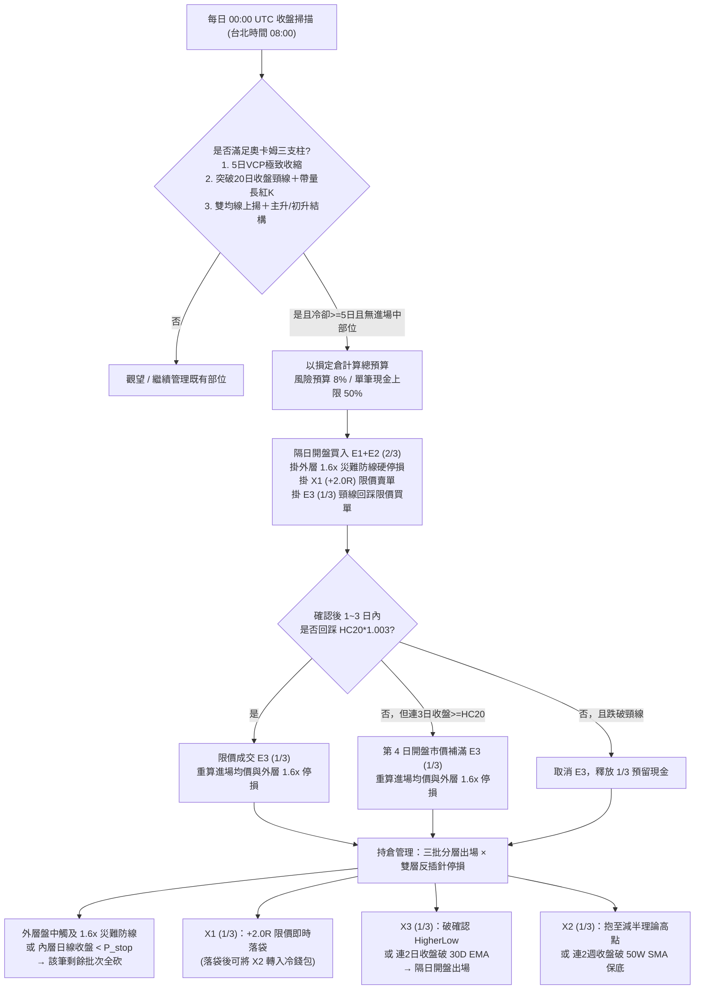

# BTC 奧卡姆三支柱 VCP＋帶量長紅 K「反險惡交易所實盤版 (v2)」完整策略規則書

> [!IMPORTANT]
> 本規則書與實際回測引擎 [`vcp_bull_strategy.py`](file:///home/antigravity/bitcoin-analyzer/scripts/btc_bottom/vcp_bull_strategy.py) 及 TradingView 腳本 [`btc_vcp_3tranche_tradingview.pine`](file:///home/antigravity/bitcoin-analyzer/reports/btc_vcp_3tranche_tradingview.pine) **100% 逐條對齊**。所有條件皆為嚴格因果（零未來函數、零寫死日期），人類交易員或程式交易機器人均可直接照表執行。

---

## 0. 策略全景流程圖

---

## 1. 交易標的、時間週期與基礎指標定義

- **交易標的**：BTC/USD 或 BTC/USDT **現貨（100% 現貨、嚴禁永續合約槓桿）**。
- **時間框架**：
  - **日線（`1D`）**：以 **`UTC 00:00`** 為每日換日點（台北時間早上 `08:00`）。令昨日剛收盤的 K 棒為第 $d$ 根，其開高低收量記為 $O_d, H_d, L_d, C_d, V_d$。
  - **週線（`1W`）**：僅讀取**已正式收盤**的完整週 K（週一 `00:00 UTC` 結算），絕不使用盤中未收盤的當週價格。
- **使用到的全部指標（僅 7 個標準教科書指標）**：
  1. `EMA20`、`EMA30`、`EMA50`：收盤價之 20 / 30 / 50 日指數移動平均線（SMA 播種）。
  2. `SMA200`：收盤價之 200 日簡單移動平均線（日線牛熊年線）。
  3. `VolSMA20`：成交量之 20 日簡單移動平均線。
  4. `ATR14`：14 日真實波幅均值（Wilder 平滑法）。
  5. `50W SMA`：已收盤週線收盤價之 50 週簡單移動平均線（宏觀熊市保底線）。
  6. `Daily Pivot Low (5, 5)`：因果波段低點——當某日最低價 $L_k$ 嚴格為前後各 5 根日 K（共 11 根）之最低點時，在 $k + 5$ 日收盤正式確認（零前瞻）。
  7. `MVRV`（僅用於 `X2` 減半高點）：採用 CoinMetrics `CapMVRVCur`，**嚴格限定讀取前一日 `MVRV[d-1]`**。

---

## 2. 進場觸發規則：奧卡姆三支柱（於日線收盤 $C_d$ 一次性判定）

每一天日線收盤（`23:59:59 UTC`）檢查是否**同時滿足**以下三大支柱；只要全部成立，即宣告第 $d$ 日為**「有效帶量長紅 K 突破確認日」**：

### 支柱一：突破前 5 日極致 VCP 波動收縮（僅看 `[d-5 .. d-1]`）
定義突破日前 5 根 K 棒與前 20 根 K 棒之高低價與最高收盤價：
- $H_5 = \max(H_{d-5 \dots d-1})$、$L_5 = \min(L_{d-5 \dots d-1})$
- $H_{20} = \max(H_{d-20 \dots d-1})$、$L_{20} = \min(L_{d-20 \dots d-1})$
- **20 日收盤頸線**：$\text{HC}_{20} = \max(C_{d-20 \dots d-1})$
- **5 日振幅**：$\text{Rng}_5 = \frac{H_5 - L_5}{L_5}$；**20 日振幅**：$\text{Rng}_{20} = \frac{H_{20} - L_{20}}{L_{20}}$

必須同時滿足 4 項收縮條件：
1. **末端極致窄箱**：$\text{Rng}_5 \le 8.0\%$
2. **相對波動收縮**：$\frac{\text{Rng}_5}{\text{Rng}_{20}} \le 0.80$
3. **起漲前已站穩短均**：$C_{d-1} > \text{EMA20}_{d-1}$
4. **合理初始停損區間**：令內層停損價 $P_{\text{stop}} = L_5 - 0.25 \times \text{ATR14}_{d-1}$，要求停損距離 $\frac{C_d - P_{\text{stop}}}{C_d} \in [2.0\%, 25.0\%]$（過濾極端異常 K 棒）。

### 支柱二：當日突破收盤頸線 ＋ 帶量實體長紅 K（看第 $d$ 日）
1. **有效站破 20 日收盤頸線**：$C_d > \text{HC}_{20}$
2. **實體長紅動能**：當日實體漲幅 $\frac{C_d - O_d}{O_d} \ge +2.0\%$
3. **收在 K 棒上半部（拒絕長上影線）**：$\frac{C_d - L_d}{H_d - L_d} \ge 0.50$
4. **成交量放大確認**：$V_d \ge 1.0 \times \text{VolSMA20}_d$

### 支柱三：短中期均線共振向上 ＋ 防熊市死貓跳結構（看第 $d$ 日）
1. **價格站上雙均線**：$C_d > \text{EMA20}_d$ 且 $C_d > \text{EMA50}_d$
2. **雙均線皆呈 5 日上揚斜率**：$\text{EMA20}_d > \text{EMA20}_{d-5}$ 且 $\text{EMA50}_d > \text{EMA50}_{d-5}$
3. **牛市主升或初升轉強結構（二擇一）**：
   - **(a) 主升段**：$C_d > \text{SMA200}_d$；**或**
   - **(b) 初升起漲第一根**：過去 5 個交易日 `[d-5 .. d-1]` 內，至少有一天收盤在 50 日均線之下（$\min_{u \in [d-5, d-1]}(C_u - \text{EMA50}_u) \le 0$），代表行情剛由下往上強勢收復 `50D EMA`。

### 新訊號的組合層級冷卻防重疊條件
即使上述三支柱成立，還必須滿足以下兩項才會開立新單：
- **無正在分批建倉的舊單**：目前沒有任何既有部位仍處於等待 `E1+E2` 或 `E3` 的 3 日進場窗期間。
- **突破冷卻間隔**：距離上一筆已確認突破日至少經過 **`5` 天**（$d - d_{\text{last}} \ge 5$）。

---

## 3. 資金管理與倉位大小計算（以損定倉 ＋ 週期滾動複利）

定義兩個帳戶資金變數：
- `free_cash`：目前帳戶裡未被佔用的可用現金。
- `realized_capital`：帳戶已實現基準淨值（初始為本金；每當任一批次 `X1`、`X2`、`X3` 出場實現損益時，立刻將該批淨損益加入 `realized_capital`，讓已獲利資產等比例放大後續突破部位）。

新確認單的總預算 $B_{\text{total}}$ 計算公式如下：
1. **計算風險停損距離**：
   $$\text{stop\_dist} = \max\left(3.0\%,\ \frac{C_d - P_{\text{stop}}}{C_d}\right)$$
2. **以損定倉目標名目金額（單筆風險上限 `8%`）**：
   $$B_{\text{raw}} = \frac{\text{realized\_capital} \times 8.0\%}{\text{stop\_dist}}$$
3. **單筆現金上限鎖定（保留銀彈給同輪後續突破）**：
   $$B_{\text{total}} = \min\left(\text{free\_cash} \times 50.0\%,\ B_{\text{raw}}\right)$$
4. **最小開倉門檻**：僅當 $B_{\text{total}} \ge \max(\$300,\ 3.0\% \times \text{realized\_capital})$ 時才開倉；確認開倉當晚即先將 $B_{\text{total}}$ 從 `free_cash` 撥入該筆交易的專屬預留資金池（分成 3 等份，每批 $B_{\text{tranche}} = B_{\text{total}} / 3$）。

---

## 4. 三批進場執行規則（反向上假插針：`2/3` ＋ `1/3`）

> [!TIP]
> 為徹底免疫惡意交易所「盤中向上假插針誘多」，v2 取消盤中 `E1` 追高觸價單，將前兩批合併為收盤確認後隔日開盤進場，並保留完整的第 3 批回踩／站穩加碼機制。

1. **第一＋二批 `E1+E2`（佔總預算 `2/3`）**：
   - **執行時機**：確認日隔天（$d + 1$）的 **`00:00 UTC` 開盤市價買入**（實盤建議用 5~15 分鐘 TWAP 減少滑價）。
   - **開盤防呆**：若 $O_{d+1} \le P_{\text{stop}}$（隔夜直接跳空跌破內層停損），則直接**取消整筆交易**並全額退回預留現金。
2. **第三批 `E3`（佔總預算 `1/3`，3 日雙軌進場窗 `[d+1 .. d+3]`）**：
   - **路徑 A（優先：回踩頸線限價買入）**：於 $d+1$ 至 $d+3$ 期間，預掛限價買單在頸線上方 `0.3%` 處：
     $$P_{\text{pullback}} = \text{HC}_{20} \times 1.003$$
     只要這 3 天內任一天盤中最低價觸及 $P_{\text{pullback}}$，立即以限價單成交最後 `1/3`（Maker 低費率）。
   - **路徑 B（備援：強勢不回踩 → 站穩 3 日第 4 日開盤補滿）**：若 $[d+1 \dots d+3]$ 連續 3 天都沒有回踩到 $P_{\text{pullback}}$，但**連續 3 天日線收盤價全部守在頸線之上**（$C_{d+1} \ge \text{HC}_{20}$ 且 $C_{d+2} \ge \text{HC}_{20}$ 且 $C_{d+3} \ge \text{HC}_{20}$），則在 **$d + 4$ 開盤市價買入**最後 `1/3`（前提 $O_{d+4} > P_{\text{stop}}$）。
   - **路徑 C（轉弱放棄）**：若 3 天內既沒回踩成交、又沒能連 3 日收穩在 $\text{HC}_{20}$ 之上，則於 $d + 3$ 收盤後**取消 `E3`**，將未用掉的 `1/3` 預留現金退回 `free_cash`。
3. **進場股數分配至出場桶**：每當 `E1+E2` 或 `E3` 成交時，將該次買入的 BTC 顆數與成本**均分**給該筆交易旗下所有「尚未平倉」的出場桶（正常情況下 `X1 / X2 / X3` 各分得精確 `1/3`；若 `E3` 買入前 `X1` 已先止盈，則 `E3` 均分給剩餘的 `X2` 與 `X3`）。

---

## 5. 雙層反插針初始停損規則（跌破無條件全砍）

每筆突破單一經建立，就同時啟動**內外雙層停損防線**；**任一層觸發時，什麼都不管，該筆交易旗下所有尚未平倉的批次（`X1 / X2 / X3`）一律全數砍倉**，並立刻取消尚未成交的 `E3` 預留單：

1. **內層防線｜日線收盤硬停損（100% 免疫交易所盤中向下掃損假針）**：
   - **停損價**：$P_{\text{stop}} = L_5 - 0.25 \times \text{ATR14}_{d-1}$（鎖定於突破前 5 日箱體最低點下方 `0.25 ATR`，整筆交易期間**絕不隨 `X1` 獲利而提早上移至保本**，避免牛市正常洗盤把 `X2` 長線底倉掃出）。
   - **觸發方式**：盤中無論插針多深都不動作；**僅在每日收盤 `23:59 UTC` 判定 $C_t < P_{\text{stop}}$ 時，於隔日 `00:00 UTC` 開盤無條件市價全砍**。
2. **外層防線｜盤中 `1.6x` 遠端災難硬停損（專防黑天鵝閃崩）**：
   - **停損價**：依最新加權進場均價 $\bar{P}_{\text{entry}}$ 計算：
     $$P_{\text{cat}} = \bar{P}_{\text{entry}} - 1.6 \times \max\left(3.0\% \times \bar{P}_{\text{entry}},\ \bar{P}_{\text{entry}} - P_{\text{stop}}\right)$$
     （在 `E1+E2` 成交時設定一次，若 `E3` 成交則依新均價更新一次；通常落在進場價下方約 `-8% ~ -13%`，遠離一般掃損針區域）。
   - **觸發方式**：直接掛在交易所原生的 Stop-Market 條件單；一旦盤中瞬間閃崩觸及 $L_t \le P_{\text{cat}}$，立刻盤中全數止損砍倉，鎖死極端黑天鵝風險。

---

## 6. 三批分層出場規則（`X1 / X2 / X3` = `1/3 : 1/3 : 1/3`）

### 出場第 1 批 `X1`（1/3）：短期報酬 `+2.0R` 即時限價獲利
- **目標價**：
  $$R_{\text{dist}} = \max\left(3.0\% \times \bar{P}_{\text{entry}},\ \bar{P}_{\text{entry}} - P_{\text{stop}}\right)$$
  $$P_{\text{TP1}} = \bar{P}_{\text{entry}} + 2.0 \times R_{\text{dist}}$$
- **執行方式**：買進後立刻預掛限價賣單（Limit Sell, Maker 費率），盤中最高價 $H_t \ge P_{\text{TP1}}$ 即刻落袋；`X1` 出場後，回收本金與獲利立即投入後續新突破，且 `X2 / X3` 維持原雙層停損不動。

### 出場第 2 批 `X2`（1/3）：事前減半理論高點 ＋ 雙週破 `50W SMA` 熊市結構保底
`X2` 不受任何日線短中均線（`20/30/50 EMA`）震盪影響，專心抱大波段；除觸及雙層初始停損外，當以下**任一條件先到**即收割出場：

#### 條件 2A：零前瞻「牛市減半理論高點」（僅依歷史已完成週期與前日數據事前推論）
已知比特幣協議減半日期（`2012-11-28`、`2016-07-09`、`2020-05-11`、`2024-04-20`、未來預估 `2028-04`），記當日距最近一次已發生減半之天數為 $T_h$。所有目標於**前一日收盤（$t-1$）即可事前算出**：
1. **理論見頂時間窗 `[win_lo, win_hi]` 與中心日 $t_{\text{theo}}$**：
   - 若過去已完成減半週期數 $\le 1$（2017 年以前）：預設 $t_{\text{theo}} = 525$ 天、時間窗 $[480, 560]$ 天。
   - 若過去已完成 $\ge 2$ 輪週期：取最近 2 輪已完成週期的「減半日至牛市最高點天數」平均值，設 $t_{\text{theo}} = \max(515, \text{round}(\text{mean}))$，時間窗為 $[t_{\text{theo}} - 45,\ t_{\text{theo}} + 35]$ 天（例如 2025 年前已知 2017 為 526 天、2021 為 548 天 → 事前推論 $t_{\text{theo}} = 537$ 天、時間窗 $[492, 572]$ 天）。
2. **理論估值目標價 $P_{\text{theo}}$（Welford 因果對數成長通道上軌衰減）**：
   - 用創世區塊 `2009-01-03` 至**前一日 $t-1$** 的全歷史價格做線上中心化對數回歸 $\log_{10}(P) = a + b \log_{10}(\text{days})$，得中軌 $\hat{y}_{t-1}$ 與標準差 $\sigma_{t-1}$。
   - 取上一輪已完成牛市頂部的對數 Z 值 $Z_{\text{prev}}$，施加 `0.72x` 邊際遞減衰減：$Z_{\text{theo}} = \max(0.18,\ 0.72 \times Z_{\text{prev}})$，得到事前目標價：
     $$P_{\text{theo}} = 10^{\hat{y}_{t-1} + Z_{\text{theo}} \cdot \sigma_{t-1}}$$
3. **理論鏈上估值目標 $\text{MVRV}_{\text{theo}}$**：
   - 取上一輪已完成牛市頂部之 `MVRV` 峰值，施加 `0.78x` 衰減：$\text{MVRV}_{\text{theo}} = \max(2.25,\ 0.78 \times \text{MVRV}_{\text{prev}})$，嚴格比對**前一日 `MVRV[t-1]`**。
4. **觸發條件（滿足任一即於當日出場 `X2`）**：
   - **提早過熱觸頂（估值雙達標）**：$T_h \ge 300$ 天，且盤中觸及限價目標 $H_t \ge P_{\text{theo}}$，且前日 `MVRV[t-1]` $\ge \text{MVRV}_{\text{theo}}$ → 以限價 $P_{\text{theo}}$ 成交。
   - **進入減半見頂時間窗**：$T_h \in [\text{win\_lo}, \text{win\_hi}]$ 期間，只要滿足「盤中 $H_t \ge P_{\text{theo}}$（限價）」**或**「前日 `MVRV[t-1]` $\ge \text{MVRV}_{\text{theo}}$（收盤市價）」**或**「到達理論見頂中心日 $T_h \ge t_{\text{theo}}$（收盤市價）」，即全數收割 `X2`。

#### 條件 2B：宏觀熊市結構保底（防未來 4 年減半週期失效）
- 只要該筆交易開倉以來**曾經歷過至少 1 根週線收盤站上 `50W SMA`**，之後一旦出現**連續 2 根已收盤週線低於 `50W SMA`**（$C_{w} < \text{50W\_SMA}_w$ 且 $C_{w-1} < \text{50W\_SMA}_{w-1}$），則於週一 `00:00 UTC` 開盤**無條件市價出場 `X2`**。

### 出場第 3 批 `X3`（1/3）：技術面轉弱提早獲利出場
自突破確認日後第 2 日起（$t > d_{\text{conf}} + 1$），每日收盤檢查以下兩項轉弱訊號，滿足任一即於**隔日 `00:00 UTC` 開盤市價出場 `X3`**：
1. **跌破新波段 Higher Low 移動停損**：每當突破後出現新的因果確認日線波段低點 `Pivot Low (5, 5)` 且高於原本的 $L_5$ 時，上移 `X3` 移動停損線：
   $$P_{\text{trail, X3}} = \max\left(P_{\text{trail, X3}},\ L_{\text{new\_pivot}} - 0.25 \times \text{ATR14}_t\right)$$
   當日線收盤 $C_t < P_{\text{trail, X3}}$（且 $P_{\text{trail, X3}} > P_{\text{stop}}$）即觸發出場。
2. **中期均線轉弱**：當 `X1` 已止盈 **或** 已持有滿 8 天（$t - d_{\text{conf}} \ge 8$）後，若出現**連續 2 日收盤跌破 `30D EMA`**（$C_t < \text{EMA30}_t$ 且 $C_{t-1} < \text{EMA30}_{t-1}$），即觸發出場。

---

## 7. 每日撮合與事件處理嚴格優先序（消除一切同日衝突歧義）

在每一個交易日 $t$，系統嚴格依照以下先後順序執行（確保任何「同日同時觸及停損與止盈」的情況一律採最保守的止損優先）：

1. **`00:00 UTC` 開盤執行排程出場**：依序執行昨日收盤觸發的 ① 內層收盤停損全砍 → ② `X2` 雙週破 `50W SMA` 保底出場 → ③ `X3` 技術面轉弱出場。
2. **`00:00 UTC` 開盤執行排程進場**：執行昨日收盤確認的新單 **`E1+E2 (2/3)`**，或連站穩 3 日第 4 日的 **`E3 (1/3)`**（均須確認 $O_t > P_{\text{stop}}$）。
3. **盤中防線優先檢查**：若盤中最低價觸及外層災難防線（$L_t \le P_{\text{cat}}$），**直接全砍該筆部位並跳過後續 `E3 / X1 / X2` 檢查**。
4. **收盤前／收盤時檢核內層停損**：若收盤 $C_t < P_{\text{stop}}$，排程明日開盤全砍並立刻取消未成交之 `E3`。
5. **盤中限價單撮合**：依序檢核 `E3` 回踩限價買單（$L_t \le \text{HC}_{20} \times 1.003$）→ `X1 (+2.0R)` 限價賣單（$H_t \ge P_{\text{TP1}}$）→ `X2` 減半理論高點限價／時間窗出場。
6. **`23:59 UTC` 收盤檢核明日排程**：更新 `X2` 是否觸發雙週破 `50W SMA`、更新 `X3` 移動停損與連 2 日破 `30D EMA`，最後掃描今日收盤是否成立**新的奧卡姆三支柱突破確認單**（排程明日開盤買 `E1+E2`）。

---

## 8. 實盤每日 `08:00`（台北時間 / `00:00 UTC`）標準操作與冷錢包 SOP

1. **資金分散與零槓桿**：
   - 全程只做 **BTC 現貨**，嚴禁合約與槓桿（零爆倉、零資金費率磨損、零穿倉 ADL）。
   - 熱錢包資金分散於 2~3 家一線高流動性交易所（如 Coinbase / Kraken / Binance），單一交易所不放超過總資產 `25% ~ 30%`。
2. **`X2` 冷錢包隔離規則**：
   - 任一筆 VCP 交易只要 **`X1 (+2.0R)` 止盈落袋**（此時現價已遠高於停損線 `+10% ~ +25%`），立即將該筆留下的 `1/3` **`X2` 長線倉提領至硬體冷錢包／多簽錢包保管**。
   - 僅在進入減半後第 `460` 天預警窗，或週線逼近 `50W SMA` 時，再分批轉回交易所準備收割，讓全週期熱錢包曝險始終壓在 `40% ~ 50%` 以下。
3. **每日 3 分鐘機械式檢查清單（台北時間每日 `08:00`）**：
   - [ ] 打開 TradingView 載入 [`btc_vcp_3tranche_tradingview.pine`](file:///home/antigravity/bitcoin-analyzer/reports/btc_vcp_3tranche_tradingview.pine)，看右上角儀表板與最新一根剛收盤日 K。
   - [ ] 若既有持倉昨日收盤 `< P_stop`、`X3` 轉弱，或週一確認連 2 週 `< 50W SMA` → 立即執行市價／10 分鐘 TWAP 出場。
   - [ ] 若今日跳出 `🔔 v2 帶量長紅K突破確認` → 依第 3 節公式算好預算，以市價／TWAP 買入 `E1+E2 (2/3)`，同時立刻掛好 3 張條件單：① 外層 `1.6x` 災難防線 Stop-Market、② `X1 (+2.0R)` 限價賣單、③ `E3 (1/3)` 頸線回踩限價買單（效期 3 天）。
   - [ ] 其餘 23 小時 57 分鐘**關掉螢幕不看盤**，絕不因盤中上下插針手動干預。
